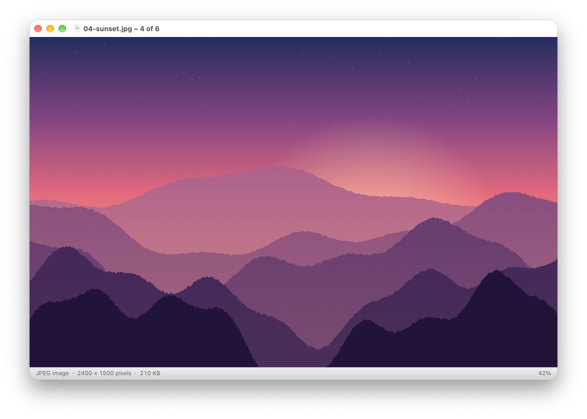

# Reaview

A fast, native macOS image viewer in the spirit of Preview.app, written in Rust.



- **← / →** step through every image in the same folder (Finder order)
- Opens anything macOS can decode: JPEG, PNG, HEIC, RAW, WebP, AVIF, GIF, TIFF, …
- Zoom to fit (⌘9), actual size (⌘0), zoom in/out (⌘+ / ⌘−), pinch to zoom
- Status bar with file type, pixel size, file size and zoom percentage
- Copy the image (⌘C) or its full path (⌥⌘C), also from the right-click menu

## Install

Download `Reaview-universal.zip` (Apple Silicon and Intel) from the
[latest release](../../releases/latest), unzip it and move `Reaview.app` to Applications.

The app is ad-hoc signed, not notarized, so the first launch needs a right-click, **Open**.
Or clear the quarantine flag: `xattr -dr com.apple.quarantine Reaview.app`.

## Build

```sh
cargo run -- path/to/image.jpg   # run from source
./scripts/bundle.sh              # build target/Reaview.app for this Mac
UNIVERSAL=1 ./scripts/bundle.sh  # arm64 + x86_64 app (needs both rustup targets)
```

Requires macOS 11+ and a Rust toolchain. For a universal build run
`rustup target add aarch64-apple-darwin x86_64-apple-darwin` once.

GitHub Actions (`.github/workflows/build.yml`) builds the universal app on every push and
pull request. Pushing a tag like `v0.1.0` also publishes `Reaview-universal.zip` as a release.
